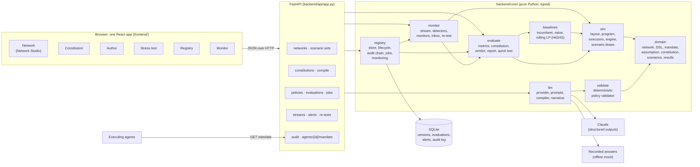
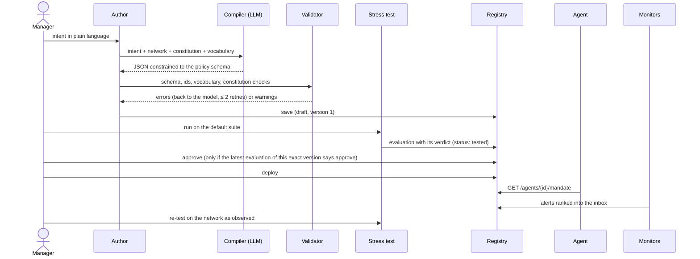

# Architecture

PolicyForge turns a supply chain manager's intent into a typed, bounded decision rule with a mandate. It
stress-tests that rule against thousands of futures, puts it through an approval gate, gives it to an agent, and
keeps checking the assumptions it rests on. This page shows how the parts fit. The reasons behind each choice are
in [DECISIONS.md](../DECISIONS.md) (D001–D070, cited below as Dnnn).

## Components

In Docker, `web` (nginx) serves the app at `/app/` and passes every other path to `api` (FastAPI on port 8000). The
app and the API therefore share one origin. Without Docker, the API serves the committed build at `/app` itself.

## The life of a policy

## Modules

| Module | Owns | Notes |
|---|---|---|
| `core/domain` | Every model, as Pydantic v2 with bounds and units; JSON Schema export; the network's reference checks and health; CSV templates | The schemas in `backend/schemas/` are generated from here, and the frontend reads them (D046, D065) |
| `core/llm` | The provider protocol, the Anthropic provider (structured outputs, effort, refusal fallbacks), the deterministic mock, prompts, the compiler loop, the narrative with its number check | The model only ever returns JSON for the schema; it never writes code |
| `core/validate` | Located errors and warnings for a policy: references, scope, constitution, sanity | Errors go back to the model; warnings go to the person signing off |
| `core/sim` | The layout (arrays from the network), the program (policies compiled to arrays), the executors, the vectorised engine, scenario draws with common random numbers | 1,000 futures × 104 weeks in about 6 s |
| `core/baselines` | The incumbent (35/10/12 days of cover), the naive rule, rolling optimisation (Pyomo + HiGHS, a persistent model with bound updates) | |
| `core/evaluate` | Metrics per future, distributions and CVaR, regret, the constitution table, the verdict and its reasons, the report and Markdown, the quick test | Every sentence of a verdict is generated from its numbers |
| `core/monitor` | The live stream (spliced worlds), observations, the reference run, CUSUM, PSI, KS and change points, the four kinds of monitor, inbox ranking, the observed network and the re-test | Limits are calibrated on the stress test's own futures (D058) |
| `core/registry` | SQLite tables, versions and content hashes, the lifecycle and approval gate, re-test flags, the hash-chained audit log with database triggers, scenario sets, background jobs, streams, alerts and re-tests | |
| `api` | HTTP for all of the above, the `X-Actor` header, CORS, serving the build | |
| `frontend` | The Network Studio, the five screens, the schema form, charts, the API client | Pure logic in `src/lib` is unit-tested |

## How the guarantees are kept

- **The LLM never runs code.** It fills a schema. Pydantic and the deterministic validator check every answer, and
  the simulator only executes validated DSL objects.
- **Determinism.** Every random draw comes from a seed, through `SeedSequence` streams per source of uncertainty,
  so every policy in a comparison sees the same futures (common random numbers). The same inputs give the same
  report id. Live streams splice worlds so the past never changes (D054).
- **One source of truth.** The Python models define every schema. The browser checks fields from the exported
  schemas, and the server checks the rest. A shared set of broken networks is tested in pytest, Vitest and
  Playwright. CI fails if the exported schemas are stale.
- **The approval gate.** A version can be approved only when the latest evaluation of that exact content says
  approve, against the active constitution and the current network. Changing either flags the policies that
  depend on it for re-test (D039, D043).
- **The audit chain.** Every change is an append-only row whose hash covers the previous one. SQLite triggers
  refuse updates and deletes, and `GET /audit/verify` finds any tampering done around them (D040).
- **Monitoring is calibrated, not guessed.** Each monitor's thresholds come from the stress test's reference run,
  for a stated false-alarm rate (D056–D058).

## Tests

| Layer | Tool | What |
|---|---|---|
| Domain, simulator, evaluation, compiler, registry, monitoring, API | pytest + Hypothesis | Round trips and bounds; conservation laws; the analytical base-stock fill rate; 20 golden intents with the mock; KPIs locked for the incumbent at a fixed seed; the agent-mandate contract; the monitoring acceptance; 95 % line coverage |
| Frontend logic | Vitest | Schema checks against the shared broken networks; edits, history, tables, projection, diff; routes, schema defaults, chart geometry |
| Whole system | Playwright | FoodNet rebuilt from scratch in the Studio; errors in place; undo and redo; versions; scenarios; **the §10 demo end to end** — against a local server, and in CI against the Docker stack |

## Runtime

- **Single process.** FastAPI runs synchronous endpoints in a thread pool. Long evaluations and re-tests go to one
  background worker thread (D064).
- **Storage.** One SQLite file: `policyforge.db` locally, `/data/policyforge.db` on the Docker volume.
- **Configuration** (environment variables):
  - `POLICYFORGE_DB`;
  - `LLM_PROVIDER` (`mock` or `anthropic`), `LLM_MODEL` (default `claude-opus-5-5`), `ANTHROPIC_API_KEY`;
  - `POLICYFORGE_CORS`.
